# ثبات · Thabat

**خطوة ثابتة كل يوم** — One steady step every day.

An Arabic-first habit tracker for Android and iOS, built with Flutter. Build good habits, break bad ones, keep your streaks, and get gentle reminders. Full RTL layout in Arabic, plus English and French.

<p align="center">
  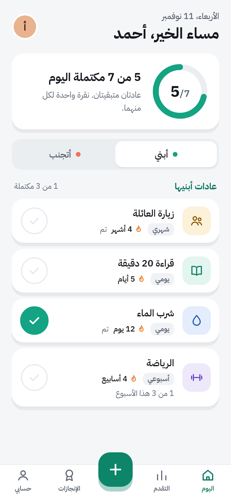
  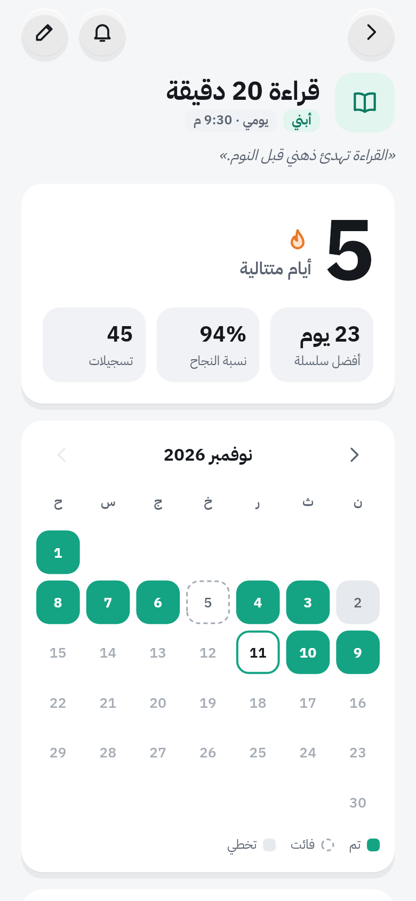
  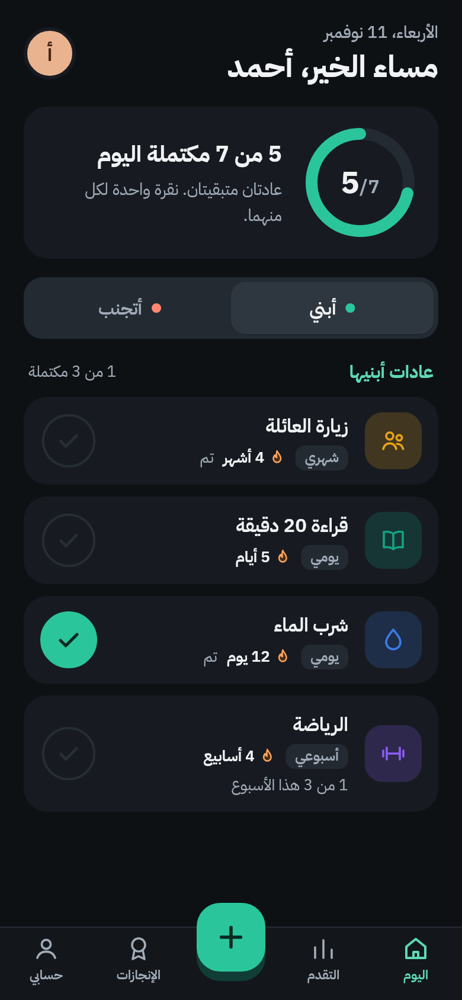
</p>

## Features

- **Good and bad habits.** Daily, weekly (X times or specific days) or monthly, with an optional goal.
- **One-tap check-in** with a pop animation and haptic feedback. Bad habits have a gentle "تعثرت" (I slipped) button.
- **Swipe actions** on each card: edit, skip, delete (with undo), or swipe the other way to mark done.
- **Streaks and stats:** current and best streak, success rate, days clean, goal progress with milestones.
- **Progress charts** for the last 7 days and the last 6 months, filterable by all / good / bad.
- **9 badges** with a confetti celebration when you unlock one or reach a goal.
- **Reminders** as local notifications, an evening "streak at risk" alert, and quiet hours.
- **Google sign-in** with data stored in **Supabase**. Works offline and syncs when the connection returns.
- **Arabic (default), English, French**, switchable instantly. Light, dark or automatic theme.

## Screenshots

### Arabic (RTL)

| Sign in | Today: build | Today: avoid |
|:-:|:-:|:-:|
| 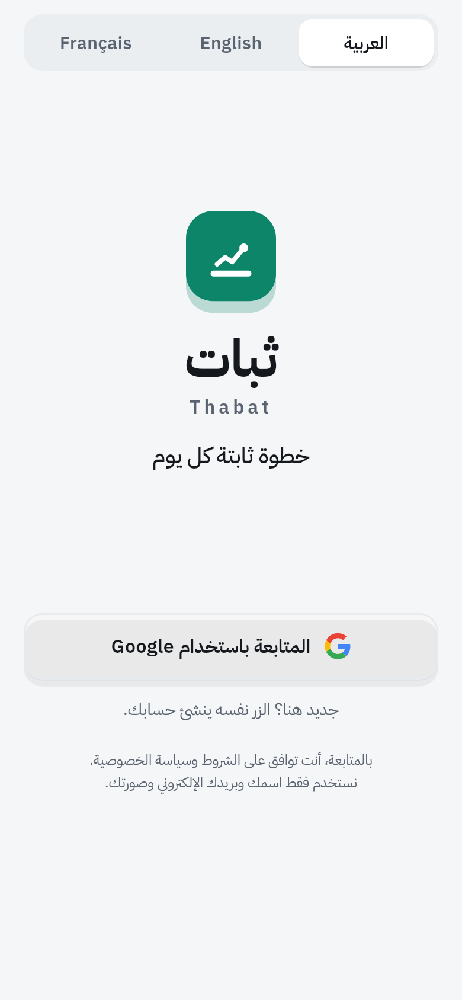 |  | 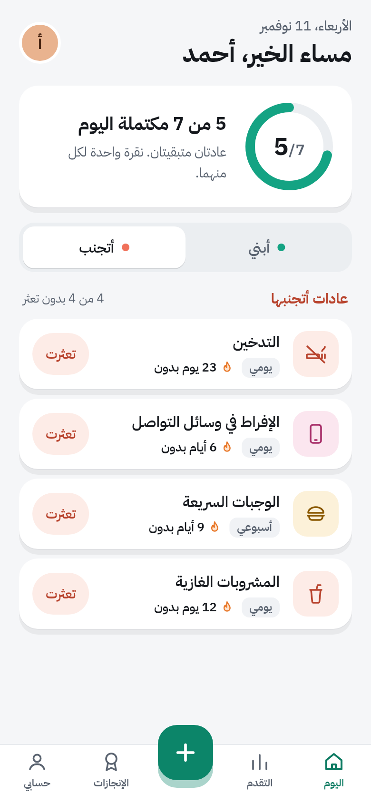 |

| Habit detail | New habit | Progress |
|:-:|:-:|:-:|
|  | 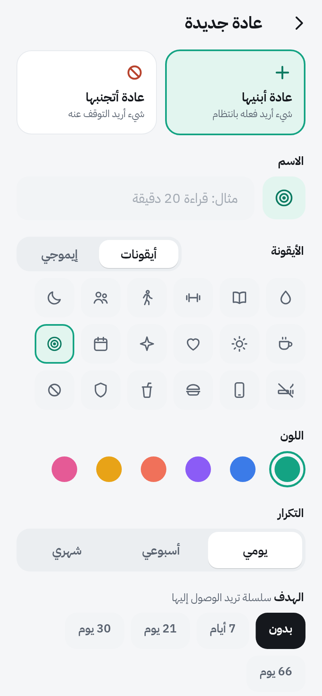 | 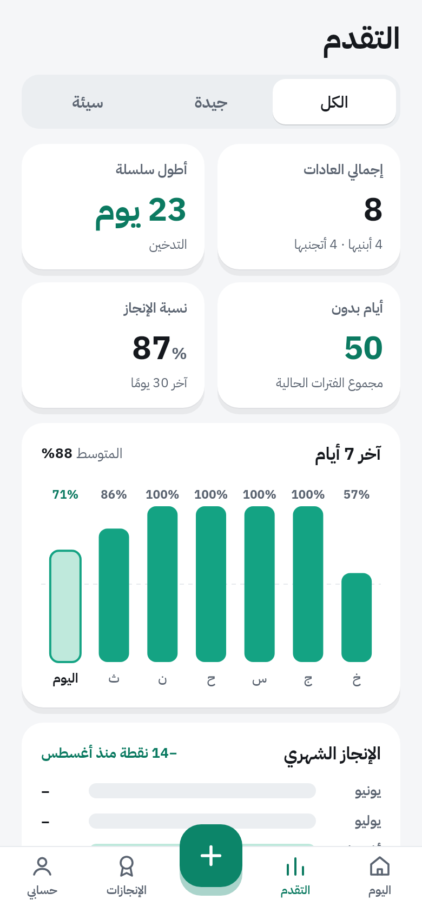 |

| Achievements | Profile & settings | Reminders |
|:-:|:-:|:-:|
| 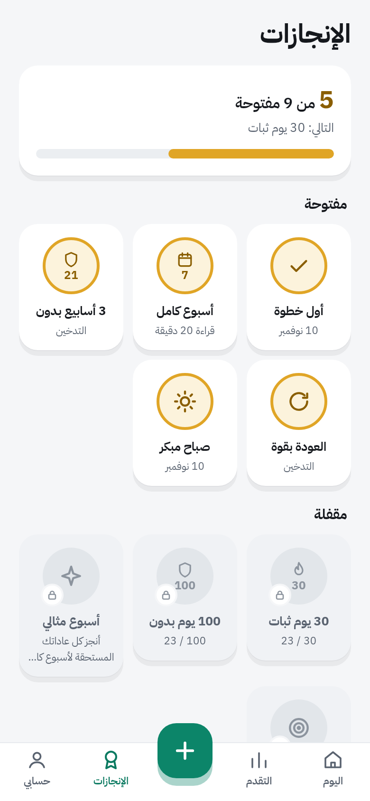 | 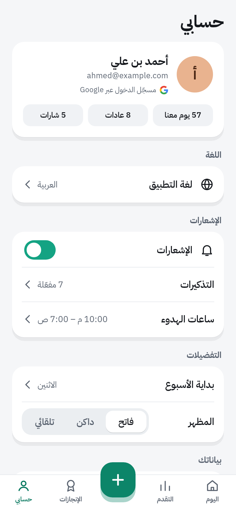 | 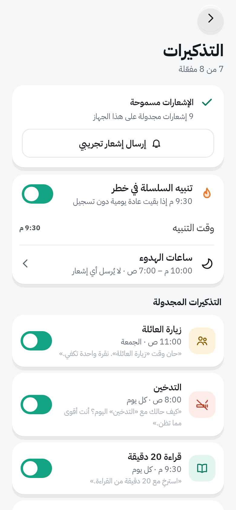 |

### Dark theme

| Today | Bad habit detail |
|:-:|:-:|
|  | 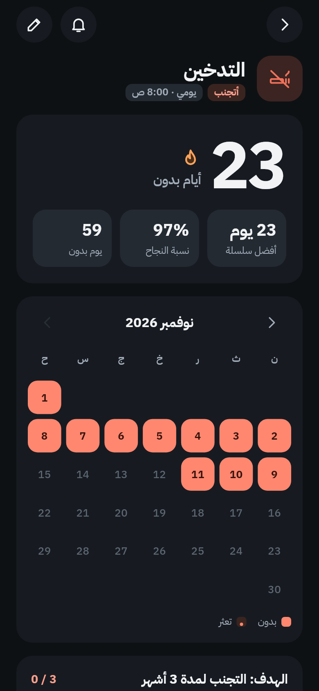 |

### English and French (LTR)

| Today (English) | Progress (English) | Today (French) |
|:-:|:-:|:-:|
| 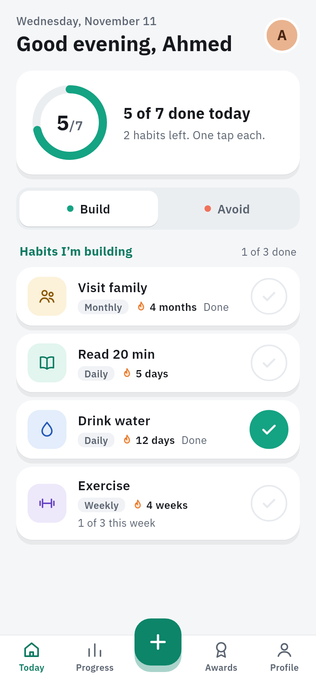 | 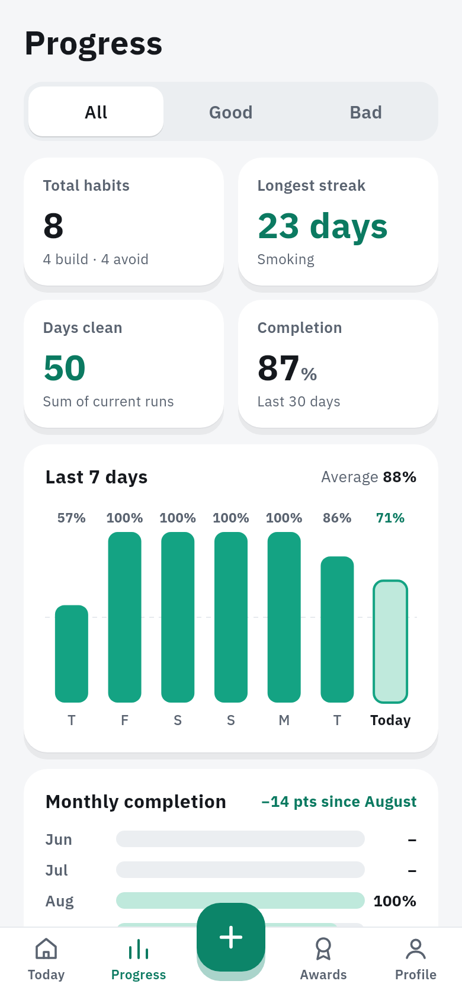 | 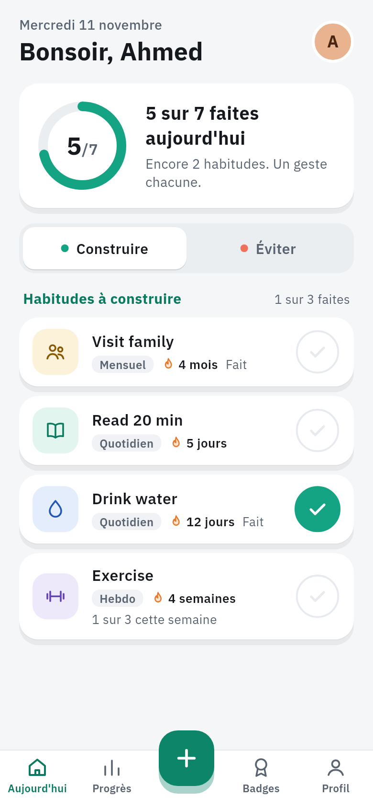 |

The screenshots are rendered by a test, so they always match the current code (see [Updating the screenshots](#updating-the-screenshots)).

## Tech stack

| Area | Choice |
|---|---|
| UI | Flutter, Material 3, IBM Plex Sans Arabic + IBM Plex Sans (bundled) |
| State | Riverpod 3 + riverpod_generator |
| Navigation | go_router with a sign-in redirect |
| Backend | Supabase: Auth (Google), Postgres with row-level security |
| Sign-in | google_sign_in (native account picker) → `signInWithIdToken` |
| Models | freezed + json_serializable |
| Reminders | flutter_local_notifications + timezone |
| Charts and animation | fl_chart, confetti, Lottie |
| Languages | ARB files: `app_ar.arb` (template), `app_en.arb`, `app_fr.arb` |

## Project structure

```
lib/
  core/        config, theme, l10n, router, utils, shared widgets
  features/
    auth/          Google sign-in, sign-in screen
    habits/        models, streak/stat logic, Supabase sync, Today / editor / detail
    progress/      stats and charts
    achievements/  badge rules, badge grid, celebration overlay
    notifications/ scheduling, reminders screen
    settings/      preferences, language, export, delete account
supabase/migrations/   database schema + RLS policies
screenshots/           screenshot generator
test/                  unit + widget tests
docs/                  setup guide and screenshots
```

## Getting started

### 1. One-time setup: Supabase and Google sign-in

The database is already created in the Supabase project **thabat**. You only need to connect Google: create the OAuth clients in Google Cloud, then enable Google in Supabase. Follow the step-by-step guide in **[docs/SETUP_SUPABASE_GOOGLE.md](docs/SETUP_SUPABASE_GOOGLE.md)**.

### 2. Install dependencies and generate code

```bash
flutter pub get
```

```bash
dart run build_runner build --delete-conflicting-outputs
```

### 3. Run or build

Pass your Google **Web** client ID when building. Without it the app runs, but sign-in says it isn't configured.

```bash
flutter run --dart-define=GOOGLE_WEB_CLIENT_ID=YOUR_WEB_CLIENT_ID.apps.googleusercontent.com
```

Release APK (one file for all phones, about 68 MB):

```bash
flutter build apk --release --dart-define=GOOGLE_WEB_CLIENT_ID=YOUR_WEB_CLIENT_ID.apps.googleusercontent.com
```

Smaller APKs, one per CPU type (about 22 MB; install `app-arm64-v8a-release.apk` on most phones):

```bash
flutter build apk --release --split-per-abi --dart-define=GOOGLE_WEB_CLIENT_ID=YOUR_WEB_CLIENT_ID.apps.googleusercontent.com
```

APKs are written to `build/app/outputs/flutter-apk/`. They are signed with the debug key, which is fine for installing on your own phone but not for the Play Store.

## Notifications

Reminders are **local notifications** scheduled on the phone. They don't need a server or internet.

- The app asks for notification permission once, as soon as any reminder (or the streak alert) is on.
- **Profile → التذكيرات** shows whether notifications are allowed, how many are scheduled, and has a **Send a test notification** button.
- Reminders fire on the exact minute when Android allows exact alarms. If it doesn't, they may arrive a few minutes late, and the Reminders screen offers **Turn on exact timing**.
- **Quiet hours** (22:00–07:00 by default) skip any reminder in that window.
- If the test works but scheduled reminders don't arrive, the phone's battery saver is probably stopping the app (common on Xiaomi, Oppo, Huawei, Samsung). Set Android settings → Apps → Thabat → Battery to **Unrestricted**.

## Tests

```bash
flutter analyze
```

```bash
flutter test
```

The tests cover streaks for daily / weekly / monthly habits and every week start, skipped and slipped days, days clean, success rate, goals and all badges. They also cover offline sync, the Supabase row mapping, identical keys in the three languages, and the app flow in Arabic, English and French.

## Updating the screenshots

```bash
flutter test screenshots/take_screenshots_test.dart
```

This renders the screens with the real fonts and the sample habits (offline, with fake sign-in) into `docs/screenshots/`. It isn't part of `flutter test` because the images change every day: they show today's date and streaks.
